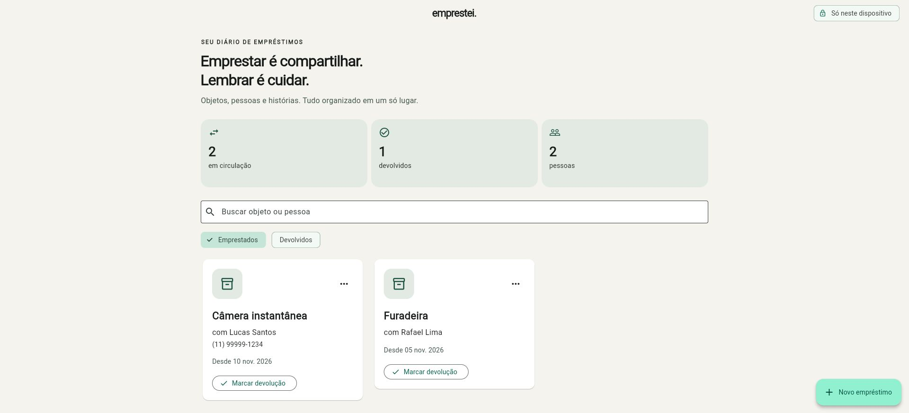

# Emprestei? · Borrowed Stuff


[](LICENSE)

An offline journal for objects you lend to other people. Register an object, its borrower, loan date and optional phone/photo; edit details, mark a return, lend again or confirm permanent deletion. Search by object or person and switch between active loans and returned objects.

Created by **Kleber de Oliveira Andrade** for Mobile Programming classes. The Portuguese UI retains the original purpose, with Material 3, responsive cards, keyboard-accessible controls, a validated form, progress, empty and retry states.



## Requirements and run

Verified toolchain: Flutter **3.41.9**, bundled Dart **3.11.5**, Chrome **157** on macOS. No backend, API key, account or Firebase configuration is needed. Do not upgrade a shared Flutter SDK just to run this project.

```sh
git clone https://github.com/kleberandrade/borrowed-stuff-flutter.git
cd borrowed-stuff-flutter
flutter pub get
flutter run -d chrome --web-port 8767
```

Use a stable host and port for Web data: IndexedDB belongs to that browser origin. In an empty journal, choose **Experimentar com exemplos locais** for three fictional loans. Examples are inserted in a transaction only when the collection is empty; existing data is never replaced. **Novo empréstimo** opens the form. Card menus expose Edit/Delete; return actions are visible buttons. Tab navigates controls, Enter/Space activates focused buttons, and the date picker supports keyboard entry. Unsaved form changes require discard confirmation.

Photos come from the gallery/file chooser and are stored as base64 in Sembast, after resizing where the platform supports it, with a 5 MB limit. The app uses no camera, location, contacts, SMS or telephone API. Phone numbers are optional and selectable for copying; calling is a possible classroom extension.

## Architecture

- `lib/models/stuff.dart`: immutable loan data, required names, non-future local calendar date and optional phone validation; legacy decoding and schema serialization.
- `lib/database/app_database.dart`: opens `borrowed_stuff.db` once at application startup; Sembast IO in the existing application documents directory, Sembast Web/IndexedDB in browsers.
- `lib/database/stuff_dao.dart`: injected `LoanRepository` boundary, CRUD keyed by the actual Sembast record key and transactional demonstration data.
- `lib/controllers/home_controller.dart`: awaited operations, loading/error state and refresh after persistence completes. Failed writes keep the displayed list intact.
- `lib/pages/`: journal/search/filters and add/edit form; `lib/components/`: photo rendering, including platform-specific legacy file support.

Sembast Web is pinned to **2.4.4+1** because newer releases require Dart 3.12. The committed lockfile captures the versions resolved with Dart 3.11.5. Obsolete Flushbar, Slidable and date-field plugins were removed in favor of Flutter controls.

## Data compatibility

Back up the native `borrowed_stuff.db` and referenced photo files before installing over an existing app. Keep the original application identifier when upgrading; this repository preserves it. Do not uninstall the old app first.

The filename, `Stuff` collection and integer record keys are unchanged. Legacy maps are read without rewriting the file at startup. The record key overrides the old embedded `id`, which could be wrong when descriptions were duplicated. Editing writes schema 2 to that same key and retains `photoPath`, adding `calendarDate`, `phone`, `photoBase64`, and `returned`. Missing new fields default to empty/false. Old empty fields/future dates remain readable; editing requires valid current input. Deleting affects only the selected key.

Legacy epoch dates are interpreted in the current device timezone, as the original app did. Schema 2 also stores a timezone-independent `YYYY-MM-DD` calendar date. The original timezone cannot be recovered from legacy records alone. New photos no longer depend on temporary file paths. Existing photos display on native platforms when their files still exist; an unavailable photo shows a placeholder without deleting its path. Native files are not automatically imported into the browser. Web and native journals are separate; clearing browser site data removes the Web journal. There is no sync/export feature or encryption layer.

## Validation

```sh
dart format --output=none --set-exit-if-changed lib test
flutter analyze
flutter test --coverage
flutter build web
# Optional native checks, requiring platform tooling and user-accepted licenses:
flutter build apk --debug
flutter build ios --simulator --no-codesign
```

Tests cover invalid inputs, legacy calendar dates/photos, duplicate descriptions and incorrect embedded IDs, schema updates, deletion, file close/reopen compatibility, idempotent examples, embedded photo persistence, controller failure/retry and a mobile-width widget flow through validation, create and return. `coverage/lcov.info` is generated locally; no coverage percentage or mutation score is claimed. Crapper, Dryer and Mutator are installed but do not support Dart; their scans find no supported source files.

The GitHub workflow `.github/workflows/flutter.yml` runs formatting, analysis, tests and Web compilation on `master` pushes and pull requests, using Flutter 3.41.9. See [the workflow runs](https://github.com/kleberandrade/borrowed-stuff-flutter/actions/workflows/flutter.yml) for actual remote status. See [the verification log](docs/WORK_LOG.md) for native build results, real browser checks and limitations. Browser automation could not complete photo selection because its extension disallows local file access; persistence of photo payloads is covered separately. No physical phone validation is claimed.

Android configuration uses the current Flutter plugin DSL, AGP 8.11.1, Kotlin 2.2.20, Java 17 compilation and Android API 24 minimum. iOS 15 minimum is aligned with the installed Xcode 27 toolchain and the gallery usage description is included. Debug simulator builds select the host architecture to work around the [Flutter 3.41 / Xcode 27 lipo issue](https://github.com/flutter/flutter/issues/188461); device release architectures are unaffected. Native configurations are retained, with no store signing or deployment supplied.

## Classroom notes and credits

The [original Portuguese tutorial](https://medium.com/@kleberandrade/criando-um-aplicativo-para-lembrar-dos-objetos-emprestados-com-flutter-e-sembast-6dbf350a7a56) teaches this app. [The concrete tutorial revision](docs/medium-update.pt-BR.md) tracks modern APIs and commands. The [historical README](docs/legacy-readme.pt-BR.md) preserves original screenshots, exercises, credits and MIT text; its Dart 2 instructions are historical.

The [Flutter Community article on calls/SMS/email](https://medium.com/flutter-community/flutter-making-phone-calls-sending-sms-and-emails-with-url-launcher-56414b06f84e) is a third-party reference for an optional exercise; it is not part of the implementation and was not edited. Possible next exercises: phone intents with explicit user actions, due dates, export/restore, and list animations respecting reduced-motion settings.

MIT, copyright 2020 Kleber de Oliveira Andrade. See [LICENSE](LICENSE). Third-party packages and Flutter assets retain their own licenses.
