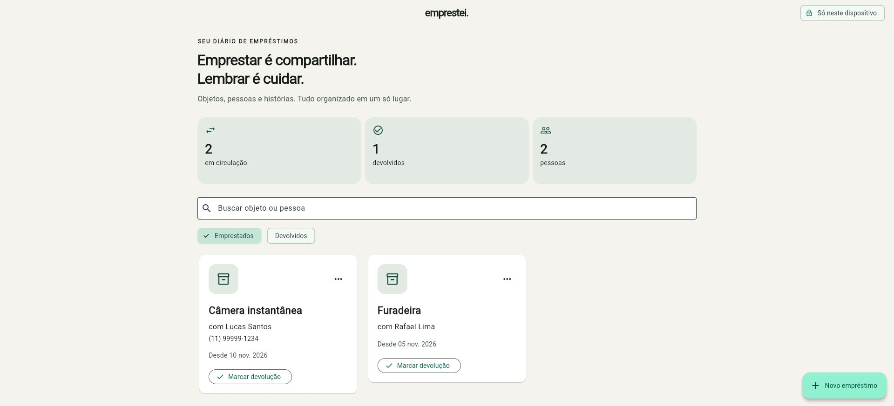
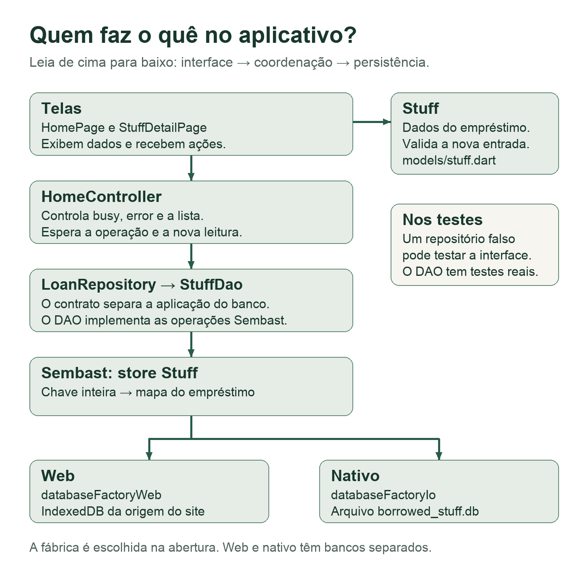
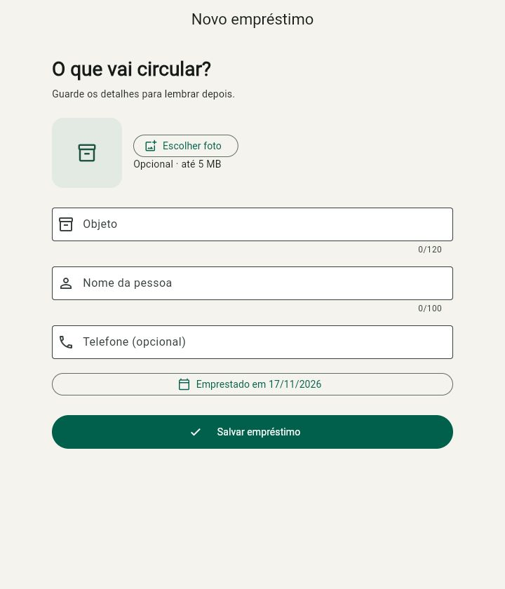
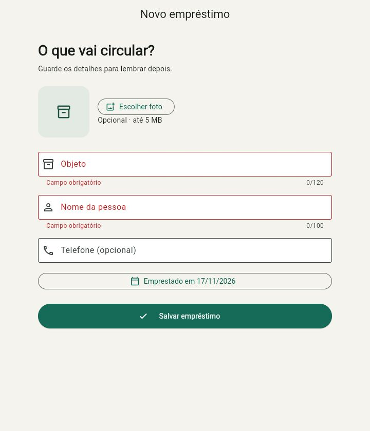
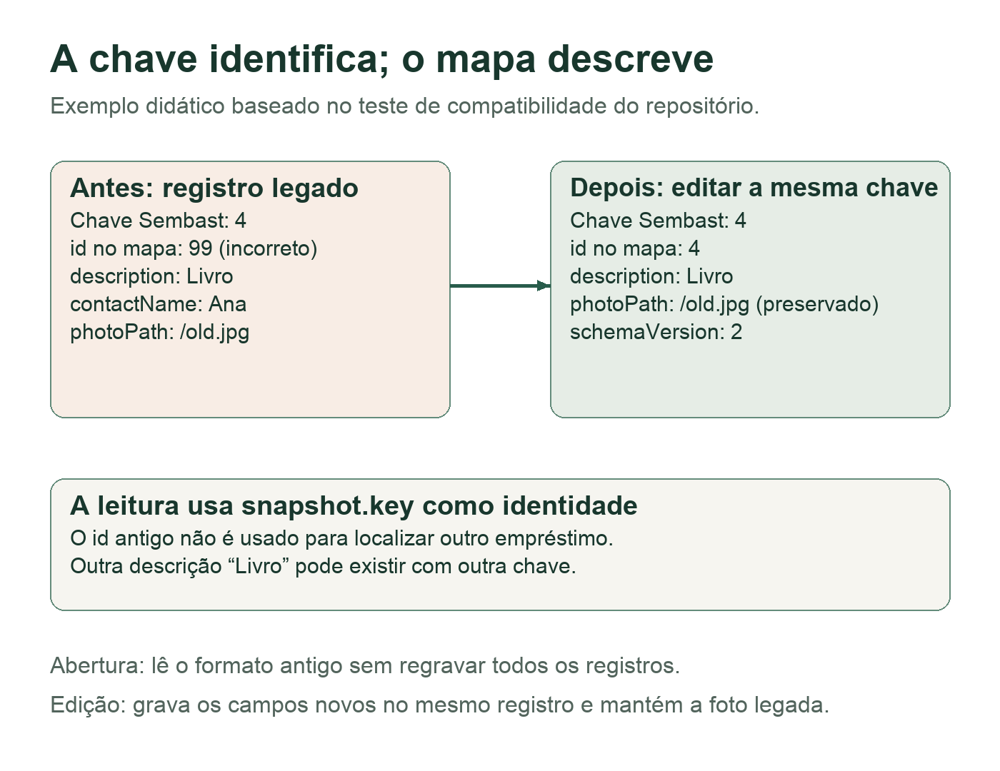
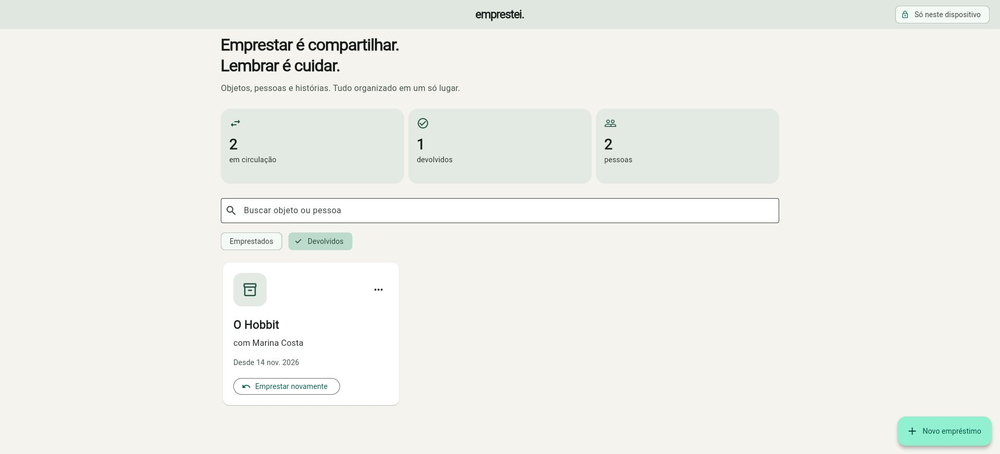
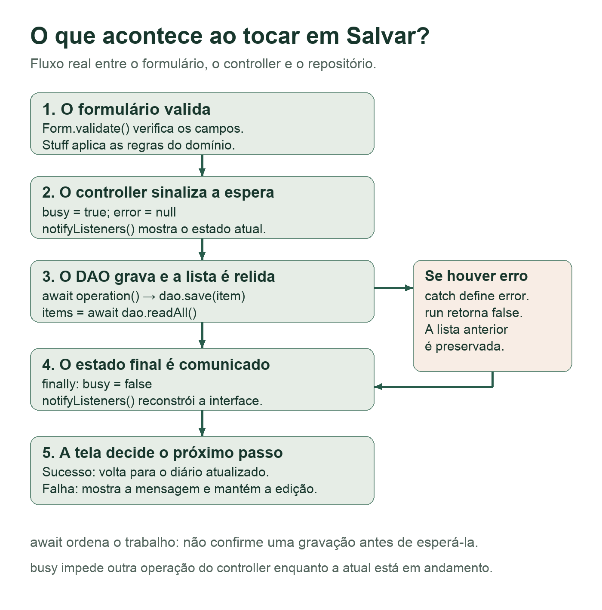

# Criando um aplicativo para lembrar dos objetos emprestados com Flutter e Sembast

## Notas de aula do professor Kleber de Oliveira Andrade

Você emprestou um livro para uma amiga. Algumas semanas depois, lembra do livro, mas não sabe se ele já voltou. Esse pequeno problema será o ponto de partida da nossa aula: construir o Emprestei?, um diário local de objetos emprestados.

Vamos acompanhar o caminho completo de um empréstimo: preencher o formulário, validar os dados, gravar no banco, exibir na tela e registrar a devolução. Também veremos como atualizar um aplicativo sem perder os registros de quem já usava a versão anterior.

Edição atualizada em 17/11/2026: Flutter 3.50.0, Dart 3.14.0 e pacotes atuais compatíveis. A capa foi criada especialmente para esta aula com auxílio de IA; ela é uma ilustração, não uma captura do aplicativo. As capturas reais do app, os diagramas e o código aparecem ao longo da aula; os arquivos também estão no repositório.

### Antes de começar: o que você precisa saber

Tenha uma noção de variáveis, classes, construtores e widgets em Dart/Flutter. Se Future e async/await ainda forem novidade, pense assim: uma operação de banco pode levar algum tempo; await permite aguardar o resultado antes de continuar, sem bloquear a interface durante essa espera.

O objetivo é entender e experimentar o projeto completo. Os trechos abaixo destacam as decisões principais; não são um aplicativo inteiro para colar em um único arquivo. Abra os arquivos indicados em cada etapa e mantenha os imports correspondentes. Você não precisa de Firebase, conta em serviço externo ou chave de API.

Ao terminar a aula, você deverá conseguir explicar a diferença entre modelo, tela, controller e repositório; executar um CRUD no Sembast; distinguir a chave de um registro do seu conteúdo; e verificar a persistência fechando e reabrindo o aplicativo.

### Etapa 1 — Execute o app e observe o comportamento

Use Flutter 3.50.0, que inclui Dart 3.14.0, e tenha o Chrome instalado. O arquivo .flutter-version registra a versão adotada pelo projeto. Se você usa outros projetos com uma versão anterior, mantenha uma instalação separada para esta aula: não é necessário substituir o SDK usado por eles.

```sh
flutter --version
flutter doctor
git clone https://github.com/kleberandrade/borrowed-stuff-flutter.git
cd borrowed-stuff-flutter
flutter pub get
flutter run -d chrome --web-port 8767
```

Confira a versão informada pelo primeiro comando antes de continuar. O projeto agora exige Dart 3.14 ou superior e Flutter 3.50 ou superior. Se a resolução das dependências falhar com um SDK antigo, corrija a versão selecionada; apagar o lockfile não resolve um requisito de SDK.

Na primeira abertura, escolha “Experimentar com exemplos locais”. O app cria três empréstimos fictícios apenas quando o diário está vazio. Busque pelo nome de uma pessoa, marque uma devolução e abra o filtro “Devolvidos”. Recarregue a página: o registro deve continuar lá.



Observe na Figura 1 como a finalidade aparece na tela: o resumo mostra quantos objetos estão fora, a busca procura objeto ou pessoa e os filtros separam a circulação do histórico. Os cartões exibem descrição, pessoa e data; o menu concentra edição/exclusão e o botão de devolução fica visível. As capturas desta aula são da versão Web em execução, não de um telefone físico.

Por que fixamos a porta 8767? O banco do navegador pertence à origem, isto é, à combinação de protocolo, endereço e porta. Abrir em outra porta pode mostrar um diário vazio, porque é outro espaço de armazenamento. Isso não significa que o banco anterior foi apagado.

### Etapa 2 — Entenda os pacotes e a separação de responsabilidades

O pubspec.yaml declara as dependências permitidas. O pubspec.lock registra as versões efetivamente resolvidas. Em um aplicativo, mantenha ambos no controle de versão para que outras pessoas e o CI consigam reproduzir a instalação.

```yaml
name: borrowed_stuff
description: An offline lending journal for objects, people and returns.
publish_to: none
version: 2.0.0+2

environment:
  sdk: '>=3.14.0 <4.0.0'
  flutter: '>=3.50.0'

dependencies:
  flutter:
    sdk: flutter
  intl: ^0.20.3
  image_picker: ^1.2.4
  path: ^1.9.1
  path_provider: ^2.1.6
  sembast: ^3.10.1
  sembast_web: ^2.4.7
  cupertino_icons: ^2.0.0
  material_ui: ^1.11.1

dev_dependencies:
  flutter_test:
    sdk: flutter
  flutter_lints: ^6.0.0

flutter:
  uses-material-design: true
```

Sembast cuida dos registros locais. Sembast Web oferece a mesma API sobre IndexedDB. path_provider localiza a pasta de documentos nas plataformas nativas, e path monta o caminho do arquivo. image_picker seleciona a foto. intl apresenta datas no formato esperado. flutter_test e flutter_lints ajudam a testar e analisar o código.

Nesta versão do Flutter, os componentes Material vêm do pacote oficial material_ui. Por isso, os arquivos de interface importam package:material_ui/material_ui.dart, em vez do antigo package:flutter/material.dart. As traduções Material também vêm desse pacote; a configuração usada no app é GlobalMaterialLocalizations.delegates. Essa migração mantém o projeto em Flutter.

Todos os pacotes diretos e de desenvolvimento estão nas versões estáveis atuais resolvíveis com esse SDK. Três dependências transitivas continuam abaixo da versão mais recente publicada: cross_file é limitado pelos pacotes de seleção de imagem; material_color_utilities e test_api têm versões fixadas pelo próprio Flutter. Não usamos dependency_overrides para forçar combinações que os mantenedores não declararam compatíveis.

Agora abra lib e siga esta divisão. Em models, Stuff descreve um empréstimo. Em database, a abertura do banco e o DAO cuidam da persistência. Em controllers, HomeController coordena as operações e o estado. Em pages, as telas apresentam os dados e recebem as ações. Em components, fica a exibição de fotos.

Uma forma de seguir o fluxo é: botão Salvar → formulário validado → Stuff → HomeController → LoanRepository/StuffDao → Sembast → lista atualizada. A tela não precisa conhecer o formato físico do arquivo. O modelo não precisa saber qual botão foi pressionado.



Leia a Figura 2 de cima para baixo. A tela cria um Stuff a partir da entrada; o controller coordena a operação; o DAO executa a persistência. LoanRepository é o contrato que permite trocar a implementação nos testes. Os dois blocos na base são alternativas escolhidas ao abrir o app: um arquivo nativo não é compartilhado automaticamente com o IndexedDB do navegador. As setas representam colaboração; as caixas não são tabelas do banco.

Referência conceitual da aula original: vídeo “MVC // Dicionário do Programador”, do Código Fonte TV: https://www.youtube.com/watch?v=jyTNhT67ZyY . O vídeo é de terceiros e não foi modificado.

### Etapa 3 — Modele um empréstimo válido

Abra lib/models/stuff.dart. Os campos principais são description, contactName e loanDate. O id começa nulo porque a chave ainda será criada pelo banco. phone, photoPath e photoBase64 são opcionais; returned informa se o objeto já foi devolvido.

Os dados são imutáveis: os campos são final. Para mudar uma situação, criamos outra representação e a gravamos na mesma chave. Isso evita alterar um objeto silenciosamente enquanto a tela ainda exibe um estado anterior.



A Figura 3 mostra de onde vêm os dados do modelo. “Objeto” preenche description; “Nome da pessoa”, contactName; o seletor fornece loanDate. O telefone e a foto são opcionais. Essa correspondência ajuda a acompanhar o que sai da tela e o que será salvo no mapa.

```dart
final item = Stuff(
  description: 'O Hobbit',
  contactName: 'Marina Costa',
  loanDate: DateTime(2026, 11, 17),
  phone: '(11) 99999-1234',
);
```

Escolha uma data igual ou anterior ao dia em que executar o exemplo. O construtor remove espaços nas extremidades dos nomes, rejeita descrição ou pessoa vazia e impede uma data futura. O telefone é opcional; quando preenchido, precisa conter de 8 a 15 dígitos e apenas a pontuação permitida. Uma sequência como “--------” não é um telefone válido.

Há duas camadas de validação com funções diferentes. O TextFormField mostra uma mensagem perto do campo para orientar a pessoa. O modelo protege a regra quando o dado vem de outro caminho, como um teste ou uma futura importação. Não confie apenas no teclado ou no aspecto visual do formulário.

Veja o campo de objeto em lib/pages/stuff_detail_page.dart. Este trecho pertence ao State do formulário: description é seu TextEditingController e saving informa se uma gravação está em andamento.

```dart
TextFormField(
  controller: description,
  enabled: !saving,
  maxLength: 120,
  textCapitalization: TextCapitalization.sentences,
  textInputAction: TextInputAction.next,
  decoration: const InputDecoration(
    labelText: 'Objeto',
    hintText: 'Ex.: livro O Hobbit',
    prefixIcon: Icon(Icons.inventory_2_outlined),
  ),
  validator: requiredText,
)
```

O controller do campo mantém o texto digitado. maxLength limita a digitação na interface; enabled impede alterar o campo durante a gravação; validator decide se a entrada pode prosseguir. A função usada pelos campos obrigatórios é:

```dart
String? requiredText(String? value) =>
  value == null || value.trim().isEmpty ? 'Campo obrigatório' : null;
```

Em um validator do Flutter, retornar null significa “válido”; retornar uma String mostra essa mensagem como erro. No método save, form.currentState!.validate() executa os validadores. Se algum campo falhar, a função retorna antes de criar o Stuff ou chamar o repositório.



Na Figura 4, tente relacionar cada mensagem ao retorno de requiredText. O app mantém o formulário aberto para correção. Não houve cadastro incompleto no banco: a validação encerrou esse caminho antes da gravação.

Stuff.fromMap é a fronteira de leitura do armazenamento. Ela também aceita dados legados que o app antigo permitia, como campos vazios ou datas futuras. Isso evita tornar um empréstimo antigo inacessível depois da atualização. Ao editar, a pessoa deve corrigir os campos para atender às regras atuais.

Código completo: https://github.com/kleberandrade/borrowed-stuff-flutter/blob/master/lib/models/stuff.dart

### Etapa 4 — Abra o banco correto em cada plataforma

No Sembast, uma coleção é chamada store. Dentro dela, cada registro tem uma chave e um valor. Neste projeto, a store chama-se Stuff, as chaves são inteiras e os valores são mapas com os campos do empréstimo.

Nas plataformas nativas, o banco é o arquivo borrowed_stuff.db dentro da pasta de documentos do aplicativo. No navegador, não há acesso a esse caminho nativo: databaseFactoryWeb usa IndexedDB. Observe a função em lib/database/app_database.dart:

```dart
import 'package:flutter/foundation.dart';
import 'package:path/path.dart' as p;
import 'package:path_provider/path_provider.dart';
import 'package:sembast/sembast_io.dart';
import 'package:sembast_web/sembast_web.dart';

Future<Database> openAppDatabase() async {
  if (kIsWeb) return databaseFactoryWeb.openDatabase('borrowed_stuff.db');
  final dir = await getApplicationDocumentsDirectory();
  return databaseFactoryIo.openDatabase(p.join(dir.path, 'borrowed_stuff.db'));
}
```

kIsWeb seleciona a implementação. O restante do código usa a API Sembast sem precisar repetir essa escolha em cada operação. A abertura acontece no início do app; a conexão é entregue ao DAO, que é entregue ao controller.

Uma conexão que falha deve produzir um estado de erro com nova tentativa. Não basta esconder o erro atrás de um indicador de carregamento que nunca termina. Esse cuidado aparece no bootstrap do app, em lib/main.dart.

### Etapa 5 — Grave, leia, atualize e exclua pela chave

Abra lib/database/stuff_dao.dart. LoanRepository descreve as operações que a aplicação precisa. StuffDao implementa esse contrato usando Sembast. Nos testes de interface podemos fornecer outro repositório, sem depender de um arquivo real.

Veja o método de gravação:

```dart
  Future<Stuff> save(Stuff item) async {
    if (item.id == null) {
      final key = await store.add(database, item.toMap());
      return item.withIdentity(key);
    }
    await store.record(item.id!).put(database, item.toMap());
    return item;
  }

```

Se id é nulo, add cria uma chave e devolvemos um Stuff com essa identidade. Se a chave já existe, put atualiza o registro correspondente. Durante a leitura, usamos a chave do snapshot como identificador confiável.

Por que não localizar um registro pela descrição? Porque duas pessoas podem receber objetos com o mesmo nome. Dois registros “Livro” precisam continuar independentes. A descrição é conteúdo; a chave é identidade. A versão antiga podia gravar ids incorretos ao atualizar pela descrição, e essa situação está coberta pelos testes de compatibilidade.



A Figura 5 usa um exemplo do teste do repositório. O mapa antigo pode conter id errado, mas a chave 4 continua apontando para o registro certo. Na leitura, Stuff.fromMap recebe snapshot.key; na edição, store.record(item.id!).put grava naquela chave. Assim, atualizar o item não depende de uma descrição que outra pessoa também pode usar.

Para marcar a devolução de um empréstimo que já foi salvo, a operação principal é:

```dart
await dao.save(saved.withReturned(true));
```

Aqui, dao é o repositório conectado e saved é o Stuff devolvido por uma gravação anterior. O trecho deve estar dentro de uma função async. O registro permanece no banco e aparece no filtro “Devolvidos”. Marcar uma devolução não equivale a excluir o histórico.



Compare a Figura 6 com a lista inicial. A mudança está em returned: o item sai do filtro “Emprestados” e passa para “Devolvidos”. O título, a pessoa e a data continuam disponíveis. “Emprestar novamente” grava returned igual a false no mesmo registro; essa versão não cria um histórico separado de cada ciclo de empréstimo.

A exclusão usa dao.delete com a chave do item selecionado e exige confirmação na interface. Para experimentar, use apenas os exemplos fictícios. Não apague um registro real para verificar se o botão funciona.

### Etapa 6 — Entenda a espera, o carregamento e os erros

Abra lib/controllers/home_controller.dart. HomeController recebe um LoanRepository. Seu método run aguarda a operação solicitada e depois lê a lista atualizada. Enquanto isso, busy informa à tela que uma operação está em andamento.



A Figura 7 acompanha este método real de HomeController. Os comentários explicativos abaixo foram acrescentados à transcrição; as instruções são as mesmas do projeto.

```dart
Future<bool> run(Future<void> Function() operation) async {
  // Não inicia outra operação enquanto esta ainda está em andamento.
  if (busy) return false;
  busy = true;
  error = null;
  notifyListeners();
  try {
    // Aguarda a gravação/exclusão antes de reler os dados.
    await operation();
    items = await dao.readAll();
    return true;
  } catch (_) {
    error = 'Não foi possível acessar os dados. Tente novamente.';
    return false;
  } finally {
    // Libera o estado de espera tanto no sucesso quanto na falha.
    busy = false;
    notifyListeners();
  }
}
```

A operação recebida é uma função que devolve Future<void>. No cadastro, a tela entrega uma função que chama dao.save(item). O primeiro notifyListeners avisa sobre o carregamento. A atribuição de items só acontece quando readAll termina. No catch, a mensagem fica disponível e run retorna false; o finally libera busy e notifica novamente. A tela usa o retorno bool para saber se pode sair do formulário.

Um detalhe importante: esse catch cobre a operação e a releitura. Se a gravação terminar mas a releitura falhar, o dado pode já estar no banco, embora a lista anterior permaneça na tela. O estado de erro informa uma falha de acesso; ele não comprova que nenhum byte foi gravado. Recarregar a lista é a forma de verificar o estado persistido antes de repetir um cadastro.

Sem await, a tela poderia mostrar “salvo” antes de a gravação terminar. Uma falha de disco ou de acesso ao armazenamento ficaria invisível. No projeto, o estado é atualizado após a operação; se algo falhar, a lista anterior permanece disponível e aparece uma mensagem para tentar novamente.

HomePage usa ListenableBuilder para reconstruir a interface quando o controller notifica mudanças. As telas cuidam de apresentação e interação, enquanto o repositório cuida da persistência. Essa separação permite testar uma falha de gravação sem desligar o armazenamento real do computador.

Leia também lib/pages/home_page.dart e lib/pages/stuff_detail_page.dart. Você encontrará o formulário, a busca, os filtros, os cartões responsivos, o indicador de progresso, as mensagens vazias e a confirmação ao descartar alterações não salvas.

### Etapa 7 — Trate datas e fotos sem perder os dados antigos

Uma data de empréstimo representa um dia do calendário. Não precisamos saber o segundo exato em que o livro saiu da estante. A versão atual normaliza loanDate para ano, mês e dia e também grava calendarDate como YYYY-MM-DD.

O campo antigo loanDate em milissegundos continua sendo mantido por compatibilidade. Na leitura de um registro legado, ele é interpretado no fuso do dispositivo, como ocorria antes. Não é possível reconstruir o fuso original apenas a partir desse valor. As novas gravações usam calendarDate para preservar o dia do calendário entre fusos.

Para as fotos, o app chama ImagePicker().pickImage com ImageSource.gallery. O retorno é um XFile, e não o File usado nas APIs antigas. Se a pessoa cancelar, o resultado será nulo e nenhuma foto precisa ser substituída.

```dart
final file = await ImagePicker().pickImage(
  source: ImageSource.gallery,
  maxWidth: 1200,
  maxHeight: 1200,
  imageQuality: 80,
  requestFullMetadata: false,
);
if (file != null) {
  final bytes = await file.readAsBytes();
  if (bytes.length > 5 * 1024 * 1024) {
    throw ArgumentError('Escolha uma imagem de até 5 MB.');
  }
  final photoBase64 = base64Encode(bytes);
  // O formulário entrega photoBase64 ao novo Stuff ao salvar.
}
```

O trecho usa dart:convert e package:image_picker/image_picker.dart e deve ser executado em uma função async. O formulário completo trata cancelamento, erro e estado de carregamento. Ele solicita redimensionamento e qualidade onde a plataforma oferece esse recurso e limita os bytes finais a 5 MB.

Os bytes são codificados em base64 e gravados junto ao registro. Por quê? Um caminho temporário ou uma URL blob pode deixar de existir depois que a página ou o processo é encerrado. Um caminho nativo também não é uma imagem acessível no navegador.

Fotos antigas continuam referenciadas por photoPath nas plataformas nativas. Se o arquivo ainda existe, pode ser exibido. Se não existe, mostramos um marcador sem apagar o caminho salvo. A Web mostra um marcador para caminhos nativos; ela não importa automaticamente os arquivos do telefone.

A implementação atual seleciona imagens da galeria/arquivo. Ela não usa câmera, localização, contatos, SMS ou chamadas. As antigas permissões Android de câmera e armazenamento amplo não são necessárias para esse fluxo. O iOS inclui a descrição de acesso à fototeca. A configuração do projeto usa Android API 24 ou superior e iOS 15 ou superior.

Antes de atualizar uma instalação antiga, faça backup de borrowed_stuff.db e das fotos referenciadas. Preserve o identificador do app e não desinstale a versão anterior primeiro. O arquivo, a store e as chaves foram mantidos. Os mapas antigos são lidos sem regravação na abertura; ao editar, o registro recebe schemaVersion 2 e os campos novos. Campos ausentes assumem valores compatíveis, como returned igual a false.

Lembre-se: o diário nativo e o diário Web são armazenamentos separados. Limpar os dados do site remove o diário daquele navegador. Exportação, restauração e sincronização ainda não são funcionalidades prontas; uma delas será proposta nos exercícios.

### Etapa 8 — Verifique comportamento, não apenas a aparência

Execute os comandos abaixo com Flutter 3.50.0 selecionado:

```sh
dart format --output=none --set-exit-if-changed lib test
flutter analyze
flutter test --coverage
flutter build web
flutter pub outdated
```

A análise encontra problemas estáticos. Os testes de domínio verificam regras de entrada. Os testes de persistência verificam chaves, fotos, descrições repetidas e compatibilidade, incluindo fechar e reabrir um arquivo. O teste de controller simula uma falha e uma nova tentativa. O teste de widgets percorre validação, cadastro e devolução em largura de celular.

Este é um exemplo completo de teste de domínio, retirado de test/domain_test.dart. Ele pode ser lido sem abrir uma tela: a entrada contém apenas sinais de formatação no telefone, e o resultado esperado é a rejeição pelo modelo.

```dart
import 'package:borrowed_stuff/models/stuff.dart';
import 'package:flutter_test/flutter_test.dart';

void main() {
  test('phone needs digits, not just formatting characters', () {
    expect(
      () => Stuff(
        description: 'Livro',
        contactName: 'Ana',
        loanDate: DateTime(2020),
        phone: '--------',
      ),
      throwsArgumentError,
    );
  });
}
```

A função dentro de expect adia a criação de Stuff para que o teste possa observar a exceção. Se o modelo aceitar esse telefone, o teste falha. Por isso, ele verifica uma regra de negócio; não apenas se um método foi chamado. No repositório há ainda testes de memória e de arquivo para conferir o que acontece depois de fechar e reabrir o banco.

Depois, verifique o app real: registre um objeto fictício, edite a pessoa, busque pelo nome, marque a devolução e recarregue a página. Confira também a navegação com Tab e o layout em uma janela estreita. Um build aprovado não prova que o app foi executado em telefone físico.

A suíte existente tem oito testes e o workflow do GitHub executa formatação, análise, testes e build Web. Consulte o resultado real na aba Actions. Os resultados de builds nativos e os limites de validação ficam em docs/WORK_LOG.md. A automação anterior de seleção de fotos foi limitada pelo acesso a arquivos da extensão do navegador; o roundtrip dos bytes é testado separadamente no Sembast.

### Código, créditos e referências

Projeto completo: https://github.com/kleberandrade/borrowed-stuff-flutter . O README documenta a instalação e os comandos. O material histórico da primeira edição, de 2020, está em docs/legacy-readme.pt-BR.md; suas instruções de Dart 2 não devem ser usadas para a versão atual.

A referência de terceiros sobre chamadas, SMS e e-mail continua disponível para quem quiser estudar uma extensão futura: https://medium.com/flutter-community/flutter-making-phone-calls-sending-sms-and-emails-with-url-launcher-56414b06f84e . Esse artigo não foi alterado e essas ações não estão implementadas no app desta aula.

Aplicativo e notas de aula de Kleber de Oliveira Andrade, disciplina de Programação Mobile. Código sob MIT, copyright 2020 Kleber de Oliveira Andrade. Bibliotecas e referências de terceiros mantêm suas licenças e créditos. Capa original desta revisão criada com auxílio de IA.

### Cinco exercícios para consolidar e ampliar o projeto

Os exercícios abaixo são propostas de extensão, não funcionalidades já entregues. Faça um por vez: escreva o teste que descreve a regra nova, veja a falha esperada, implemente a menor mudança e execute novamente a suíte. Use registros fictícios e mantenha um commit separado por exercício. Os exercícios 2 e 3 formam uma sequência; os demais podem ser feitos separadamente.

### Exercício 1 — Proteja os limites de texto no domínio

Objetivo: impedir que outra entrada de dados contorne os limites do formulário. Hoje a interface limita o objeto a 120 caracteres e o nome a 100; transforme esses limites também em regras explícitas do modelo para registros novos ou editados.

Comece pelos testes. Verifique uma descrição com 120 caracteres e outra com 121; faça o mesmo para nomes com 100 e 101. Inclua texto vazio e espaços nas extremidades. Decida se a contagem será feita após trim e mantenha essa decisão consistente entre modelo e tela.

Dica: centralize os limites em um único lugar e reutilize-os no formulário. Preserve a leitura dos registros legados: uma atualização do app não deve esconder dados antigos só porque eles ultrapassam uma regra nova.

Critério de conclusão: valores no limite são aceitos, valores acima dele são rejeitados com mensagem compreensível e um registro antigo fora do limite continua legível. A validação funciona mesmo ao chamar o modelo diretamente em um teste, sem abrir a tela.

### Exercício 2 — Adicione uma data prevista de devolução

Objetivo: representar um prazo sem mudar o significado da data do empréstimo. Adicione um campo opcional de data prevista ao modelo, à serialização e ao formulário. Um registro sem prazo deve continuar válido, e o prazo não pode ser anterior ao empréstimo.

Antes da implementação, teste quatro casos: ausência de prazo, prazo igual ao dia do empréstimo, prazo posterior e prazo anterior. Depois crie um teste que leia um mapa antigo sem o campo novo, atualize outro atributo e confira que a migração não altera a data original.

Dica: trabalhe com dias do calendário, como loanDate, e normalize os horários. Não use o instante atual para decidir se o prazo pode ser cadastrado: um empréstimo antigo pode ter um prazo já vencido e ainda precisar ser registrado.

Critério de conclusão: o prazo pode ser escolhido, alterado e removido; os casos válidos sobrevivem a fechar e reabrir o banco; o caso inválido mostra uma mensagem; nenhum registro legado é descartado. Documente o novo campo de forma que uma versão futura consiga interpretá-lo.

### Exercício 3 — Crie o filtro “Em atraso” com um relógio testável

Objetivo: usar a data prevista do exercício 2 para responder quais objetos precisam de atenção. Defina a regra antes da interface: um empréstimo está atrasado quando não foi devolvido, tem prazo e esse prazo é anterior ao dia consultado. Vencer hoje ainda não significa estar atrasado.

Escreva uma função que receba o empréstimo e a data de referência. Teste prazo ontem, hoje e amanhã; ausência de prazo; e um objeto devolvido cujo prazo ficou no passado. Em seguida, acrescente o filtro na HomePage e ordene os atrasados do prazo mais antigo para o mais recente.

Dica: receber a data como argumento torna o teste previsível. Evite espalhar DateTime.now pelo filtro, pela ordenação e pelo contador. Combine o novo filtro com a busca já existente por objeto ou pessoa.

Critério de conclusão: a regra passa nos cinco cenários, não depende do dia em que o teste é executado e a tela mostra um estado vazio específico quando não há atrasos. Um item devolvido sai do filtro depois que a operação é persistida.

### Exercício 4 — Implemente backup e restauração com validação prévia

Objetivo: permitir transportar o diário entre instalações sem depender de copiar caminhos internos do aplicativo. Defina um JSON com versão de formato, registros e fotos incorporadas que realmente existam no backup. Informe quando uma foto legada não puder ser incluída; um caminho sozinho não transporta seu conteúdo.

Separe duas operações: analisar/validar o arquivo e efetivar a restauração. Mostre uma prévia com quantidade de registros e peça confirmação antes de substituir o diário. Para este exercício, adote explicitamente a estratégia “substituir tudo”; misturar registros de bancos diferentes por suas chaves inteiras é um problema adicional.

Escreva os testes antes da gravação: arquivo válido com ida e volta, JSON inválido, versão desconhecida, campo obrigatório ausente e falha durante a restauração. Verifique que dados antigos permanecem intactos se a entrada for rejeitada ou a transação falhar. Restaurar o mesmo backup duas vezes deve produzir o mesmo conjunto, sem duplicatas.

Dica: mantenha a validação e a transformação em funções testáveis. Execute a substituição em uma transação Sembast. Não faça gravações parciais enquanto ainda está descobrindo se o arquivo é válido.

Critério de conclusão: empréstimos, datas, situações e fotos incluídas no backup são recuperados; erros não apagam o diário; a interface informa o resultado; e a operação funciona no alvo que você disser suportar. Documente separadamente os alvos ainda não testados.

### Exercício 5 — Torne o fluxo utilizável com teclado e texto ampliado

Objetivo: verificar se alguém consegue registrar e devolver um objeto sem depender de mouse, gesto de arrastar ou texto pequeno. Percorra a tela inicial, o formulário, o seletor de data e os diálogos usando teclado. Observe a ordem do foco, os rótulos anunciados e a visibilidade de cada ação.

Crie testes de widgets para larguras de 320 e 1200 pixels e para escala de texto 2.0. Inclua um objeto e um nome longos e confira que não há overflow. Teste a mensagem de campo obrigatório, a confirmação de descarte e uma falha do repositório. Para erros, verifique tanto a mensagem quanto a possibilidade de tentar novamente.

Dica: use controles padrão e rótulos descritivos, preserve o foco visível e evite alturas fixas que cortem texto. Um teste de widgets ajuda a detectar a quebra de layout, mas não substitui experimentar o app com teclado e, quando disponível, leitor de tela.

Critério de conclusão: o fluxo principal pode ser completado com teclado, os controles têm nomes compreensíveis, o conteúdo ampliado continua acessível por rolagem e os testes não registram exceções de layout. Entregue uma pequena lista do que foi testado manualmente e screenshots reais das duas larguras.
